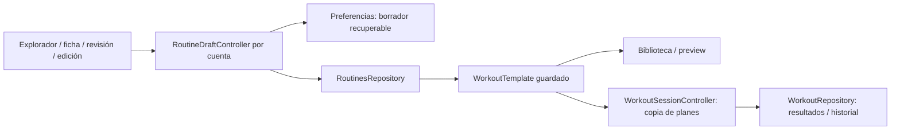

# Sistema de rutinas · auditoría y plan

Encargo: prompt maestro de rutinas del 12/10/2026 y seis capturas del usuario.
Raíz comprobada: `D:\Datos User\Escritorio\fitness\fit_app`.
Remote: `https://github.com/agusmuchu18/FIT_APP.git`.
Rama nueva: `codex/routine-system-20261012`, desde `2d764ce`.
Hay 133 cambios previos fuera de este alcance; se conservan sin reset ni push.

## Fase 0 · arquitectura y problemas comprobados antes de editar

- `template_exercise_picker_screen.dart` tiene catálogo completo con páginas de
  50, búsqueda con debounce y filtros combinables. La búsqueda omite equipamiento;
  Deporte sólo cambia un enum sin cambiar el contenido. Tarjetas usan mancuerna,
  expansión/flecha y dos acciones de agregar; etiquetas inglesas y texto redundante.
- `RoutineDraftController` conserva sólo IDs. `RoutineReviewScreen` mantiene una
  segunda lista y mapa de configuración locales: volver al explorador pierde
  configuración/nombre/notas; no hay borrador recuperable. Ambas vías deben escribir
  la misma lista de instancias configuradas, conservando IDs de catálogo.
- `WorkoutTemplate → WorkoutExercise → SetEntry` guarda planes y resultados con
  campos distintos; `WorkoutSession` es el registro realizado. `RoutineFolder`
  conserva relaciones por ID. Se reutilizan `RoutinesRepository` y preferencias
  por cuenta, sin nueva tecnología. `targetWeightKg` no distingue lastre explícito;
  falta plan por serie, metadata deportiva y notas de rutina propias.
- `RoutineEditScreen` duplica formularios; `RoutinePreviewScreen` existe pero usa
  etiquetas Weighted. Biblioteca usa grid con altura fija y tarjetas estrechas.
  `TrainingHomeController` ya tiene carpetas/orden/duplicación/uso; sus copias de
  WorkoutTemplate deben conservar todos los nuevos campos.
- `WorkoutSessionController.initialize(templateId)` copia objetivos a resultados
  sin completar. Hay que propagar objetivos por serie, descanso explícito off,
  carga/lastre/asistencia y planes/resultados deportivos hasta JSON rico e historial.
- El sistema anterior de sesión/descanso/resumen y su suite de 142 pruebas se
  preservan. `WorkoutAnalytics` se reutiliza; métricas deportivas no se convierten
  a kg ni se atribuyen a músculos sin metadatos reales.
- Diseño oficial: `docs/design/DESIGN_SYSTEM.md`, Inter, Dark Premium/turquesa,
  radios 8/12/16/24, `AppTheme.workout`, `AppSpacing`, `FitGlyph` y media local.
  Las seis capturas son evidencia visual previa; no son prueba nativa Android/iOS.
- El catálogo contiene definiciones base/extendidas y deduplicación por ID; el
  número exacto se comprobará ejecutando una prueba del catálogo, no contando
  líneas ni confundiéndolo con las 50 filas iniciales.

## Decisiones y compatibilidad

1. Ampliar los modelos existentes con campos opcionales/versionado JSON, sin
   renumerar IDs históricos ni reescribir datos al leer. Planes por serie separados
   de SetEntry realizado; un enum adicional representa lastre.
2. Borrador único por cuenta con instancias de ejercicios (duplicados sólo por
   acción explícita), nombre/notas/tipo/carpeta/modalidad y escritura serializada.
   Revisión y ficha editan este mismo controlador; fallos dejan datos recuperables.
3. Deporte ofrece sólo fútbol funcional: técnica, táctica, preparación física,
   gimnasio deportivo, competición y recuperación. Catálogo declarativo/metricas
   tipadas; otras disciplinas quedan fuera del selector hasta tener recorrido real.
   Cambiar modo conserva contenido compatible y requiere decisión para incompatible.
4. Ficha compartida configura objetivos y descanso; edición reutiliza esa ficha.
   No inventar técnica individual donde no haya contenido revisado: indicar su
   ausencia y ofrecer información de catálogo disponible.
5. Assets asociados por ID con cobertura específica/genérica/placeholder. Primero
   selección representativa; resto del catálogo tiene manifiesto y prompts pendientes.
   No bloquear funcionalidad esperando todas las ilustraciones. Imágenes generadas
   son ilustrativas, no demostración de precisión biomecánica certificada.
6. Tarjetas de biblioteca de ancho completo en móvil, tamaños adaptables, preview
   con datos reales y acciones funcionales. Carpetas eliminadas conservan rutinas.

## Etapas y aceptación verificable

A/B: modelos, borrador recuperable y contratos; pruebas JSON/aislamiento/errores.
C/D: explorador visual, traducciones/filtros y ficha/configuración; pruebas de
agregado rápido/avanzado, duplicados, validar parámetros, cobertura de catálogo.
E/F/G: revisión/edit/preview/biblioteca/carpetas; probar navegación bidireccional,
guardar/error/doble envío, orden/copia/carpetas y ausencia de recorte a 320/200%.
H/J: fútbol hasta resultados/historial y objetivos por serie en sesión existente;
probar creación→guardar→editar→iniciar→registrar→historial sin modificar plantilla.
I/K: generación progresiva, manifest/prompts, goldens reales en host, revisión de
diff, suite/analyze/web/APK. Android/iPhone y perfilado siguen limitados por no
tener dispositivo/Mac; no presentar build o goldens como ejecución móvil.

## Registro de implementación y entrega

Entrega revisada el 13/10/2026. La evidencia corresponde a la carpeta de trabajo
actual, con los cambios anteriores de otros módulos conservados. No equivale a
certificar un checkout limpio, dispositivos móviles ni una publicación en tiendas.

### 1. Resultado y recorrido implementado

El recorrido real es explorar → configurar/agregar → revisar → guardar →
biblioteca → ver rutina → iniciar → registrar resultados → resumen/historial.
La ficha y la revisión modifican el mismo borrador; volver al catálogo conserva
nombre, notas, carpeta, modalidad, orden y configuraciones. Agregar rápido usa
objetivos editables y no inventa una carga en kg. No se repite una selección por
doble toque; la duplicación intencional se ofrece en la revisión.

Gimnasio conserva los 297 IDs del catálogo y sus aliases. Fútbol tiene seis modos
funcionales: técnica, táctica, preparación física, gimnasio deportivo, competición
y recuperación. Hay 14 actividades declaradas, incluida potencia/saltos horizontales;
el gimnasio deportivo reutiliza el catálogo con una clasificación opcional de
fuerza/potencia/estabilidad/acondicionamiento elegida por el usuario. Esa etiqueta
organiza el plan y no estima beneficios físicos.

### 2. Arquitectura y responsabilidades

Se mantienen Provider/ChangeNotifier, repositorios y almacenamiento existentes.
No se añade un paquete, backend, API, servicio de imágenes en ejecución ni una
segunda capa de persistencia. `RoutineDraftController` es la autoridad del
borrador; `WorkoutTemplate` guardado es la autoridad de la plantilla. La sesión
copia sus planes con nuevas instancias y resultados inicialmente sin completar.

El modo deporte usa `SportActivityPlan` y `SportMeasurements` separados. Sus
campos tienen claves, unidades y validaciones tipadas; cada disciplina nueva
necesitará su definición y recorrido completo antes de aparecer en el selector.
La continuidad Pro anterior copia los objetivos por serie, lastre y descanso
sin modificar la plantilla ni marcar series como realizadas automáticamente.

### 3. Inventario de implementación

Rutas relativas a la raíz comprobada del repositorio:

| Área | Archivos principales |
|---|---|
| Modelo y validación | `pro/models/workout_models.dart`, `domain/sport_activity.dart`, `domain/routine_plan_validation.dart` |
| Texto de catálogo | `domain/routine_labels.dart`, `domain/routine_display_names.dart` |
| Borrador y guardado | `training_home/routine_draft_controller.dart`, `routines_repository.dart` |
| Creación/configuración | `template_exercise_picker_screen.dart`, `exercise_configuration_sheet.dart`, `routine_review_screen.dart`, `routine_edit_screen.dart` |
| Biblioteca y preview | `training_home_screen.dart`, `routine_library_card.dart`, `routine_library_actions.dart`, `routine_preview_screen.dart`, `folder_routines_screen.dart`, `training_home_controller.dart` |
| Sesión y resultados | `application/workout_session_controller.dart`, `workout_repeat_service.dart`, `domain/session_models.dart`, `workout_analytics.dart`, `presentation/workout_in_progress_screen.dart` |
| Componentes compartidos | `exercise_thumbnail.dart`, `workout_artwork.dart`, `sport_measurements_fields.dart`, `sport_session_card.dart`, `workout_report_widgets.dart` |
| Compatibilidad Pro | `pro/providers/workout_pro_provider.dart` |
| Media y documentación | `assets/images/workout/exercises/`, entrada de assets en `pubspec.yaml`, manifiesto, fuentes y `tools/export_exercise_art_manifest.dart` |

Los archivos Dart anteriores pertenecen a `lib/features/workout/`. El inventario
exacto de cada commit puede obtenerse con `git show --stat`; no incluye cambios
de código de nutrición, autenticación, hábitos ni otras áreas pendientes.

### 4. Persistencia, versiones y compatibilidad

- El JSON de plantilla añade `schemaVersion: 2`, notas y modalidad de fútbol
  opcionales. Los registros previos sin esos campos siguen leyéndose.
- `WorkoutExercise` añade `instanceId`, `setTargets`, `sportPlan`, `sportResult`
  y `sportPurpose`; los IDs y nombres almacenados del catálogo no se traducen ni
  renumeran. La traducción sólo se usa al presentar y buscar.
- `RoutineSetTarget` distingue objetivos de repeticiones fijas/rango, segundos y
  carga. `SetEntry` y `SetInSession` siguen representando resultados.
- Lastre, asistencia, carga externa, carga de máquina y peso corporal tienen
  etiquetas distintas. No se añade el peso corporal al volumen externo.
- El borrador usa `workout_routine_draft_v2` dentro del namespace existente de
  cada cuenta. La edición usa sufijo `_edit_<routineId>` para no reemplazar el
  borrador de una rutina nueva. El invitado permanece separado.
- La escritura del borrador se ordena y captura su propietario. Un fallo se
  conserva como error; guardar puede reintentar. Se elimina sólo después del
  guardado correcto o por descarte explícito.
- Guardar una rutina nueva usa un ID estable desde el borrador, con upsert y
  protección de doble envío. Un reintento no crea otra rutina.
- Borradores ilegibles o con instancias repetidas se bloquean y conservan sin
  sobrescribir. En carpetas, los datos válidos siguen visibles; si hay filas
  ilegibles, se rechazan escrituras destructivas de la colección.
- Eliminar una carpeta desasocia primero las plantillas, conserva sus IDs y
  parámetros y después elimina la carpeta. Las escrituras no constituyen una
  transacción de base de datos; un fallo parcial deja las rutinas conservadas.
- No se reescribe el historial al leer. Repetir una sesión crea una identidad
  nueva y elimina el resultado deportivo anterior del plan que se copia.

### 5. Catálogo, ficha y configuración

Se eliminan expansión inline, flecha y segunda acción de agregado. El cuerpo
abre la ficha; el círculo independiente agrega rápido o indica selección. La
búsqueda con debounce reconoce nombres, aliases, músculos y equipamiento, incluido
su nombre en español. Los filtros se combinan, se pueden limpiar y conservan
paginación de 50 hasta alcanzar el catálogo completo. No se muestra la paginación
como si fuera el total disponible. Las actividades de fútbol también se buscan.

La ficha incluye imagen, equipamiento, grupos conocidos y configuración. Hay
orientaciones técnicas básicas para los seis movimientos ilustrados; donde el
catálogo no aporta una ficha revisada se indica su ausencia. No se inventa una
demostración técnica para las otras variantes.

Se validan series 1–30, repeticiones positivas, rangos ordenados, cargas finitas
y no negativas, tiempos positivos y descanso heredado/explícito/desactivado.
Los objetivos individuales parten de los generales y conservan modificaciones
cuando cambian los generales. Una cantidad o rango incoherente bloquea guardar
con un mensaje concreto. El preview muestra los rangos y parámetros guardados.

### 6. Biblioteca, carpetas y acciones

Las tres entradas fotográficas aprobadas se mantienen. Las rutinas usan tarjetas
de ancho completo con miniatura, nombre, tipo, foco conocido, ejercicios, series,
último entrenamiento completado real y acciones Ver/Iniciar. Se conserva fijar,
editar, duplicar, mover y eliminar con confirmación. No se muestra una duración
estimada arbitraria. El filtro de tipo es funcional.

La biblioteca usa slivers y construye los elementos visibles. Una prueba con
500 rutinas comprueba que no se construyen todas las tarjetas. La fecha de última
sesión procede del historial; el orden por uso/recencia conserva eventos reales
de inicio existentes. Sin historial, la tarjeta muestra Sin estrenar.

Las carpetas se crean, renombran y eliminan; sus rutinas pasan a Sin carpeta.
La carpeta virtual no se elimina. El preview usa la versión guardada más reciente,
permite iniciar/editar y muestra un estado seguro si la rutina fue eliminada.

### 7. Imágenes, cobertura y fuentes

Se generaron y revisaron seis ilustraciones 3D anónimas: press banca, dominada
prona, sentadilla trasera, peso muerto, press militar y plancha. Están asociadas
a sus IDs y optimizadas a WebP de hasta 640 px: **71.974 bytes en total**.

`docs/design/EXERCISE_ART_MANIFEST.json` cubre los **297 IDs**: **6 específicas,
291 genéricas con ilustración específica pendiente**. Cada entrada tiene estado,
prompt, destino y regla de fallback. La ficha identifica una ilustración genérica;
un archivo ausente usa un placeholder y no bloquea el ejercicio.

`EXERCISE_ART_SOURCES_2026_10_12.json` conserva escenas, estilo, rutas de originales,
dimensiones y SHA-256 de originales/optimizados. Los PNG de mayor resolución
permanecen en las rutas locales registradas; la app incluye sólo los WebP.
No se usaron imágenes de internet con licencias desconocidas. Las ilustraciones
son media decorativa reconocible; no equivalen a certificación biomecánica.

Para actualizar la cobertura sin cambiar IDs:
`dart run tools/export_exercise_art_manifest.dart`. Las imágenes se reutilizan
en catálogo, ficha, revisión, biblioteca, preview y detalle de los resultados.
Su decodificación respeta tamaño/densidad de pantalla, limitada a 640 px.

### 8. Comprobaciones ejecutadas

| Comprobación | Evidencia del corte final |
|---|---|
| Formato de archivos modificados | `dart format`, aplicado sin omitir código |
| Análisis estricto | `flutter analyze --no-pub --fatal-infos`: 0 problemas |
| Suite completa | `flutter test --no-pub`: **170/170** |
| Catálogo | 297 IDs únicos; búsqueda/filtros y recorrido completo de páginas |
| Borrador | Recuperación de encabezado/configuración/orden; aislamiento por cuenta; JSON ilegible conservado |
| Guardado | Fallo/reintento, ID estable, doble toque y limpieza posterior al éxito |
| Parámetros | Valores inválidos, objetivos por serie, rangos, asistencia/lastre y descanso desactivado |
| Fútbol | Guardar/reabrir/iniciar/registrar/historial para cinco modalidades de actividad; gimnasio deportivo usa el flujo de gimnasio |
| Resultados | Planes inmutables, resultados deportivos no precargados, edición inválida desmarca completado |
| Carpetas/legacy | Eliminación conserva planes/IDs; filas ilegibles se preservan; continuación Pro copia objetivos |
| Teclado | Save de revisión y ficha por encima del teclado, viewport 390×844 con inset de 300 |
| Render | Goldens a 320/390/900 px y texto 200%, biblioteca, ficha, fútbol, recuperación y detalle |
| Web y APK | Web release `/FIT_APP/` y APK debug compilados con el código final |

Pruebas nuevas principales: `routine_system_test.dart` (12),
`routine_recovery_and_sport_ui_test.dart` (11) y
`routine_system_golden_test.dart` (5). Las pruebas existentes se adaptaron a la
navegación, etiquetas y componentes nuevos conservando sus contratos; no hay
tests omitidos ni diagnósticos silenciados. Los fixtures no se guardan como
historial de producción.

### 9. Revisión visual y accesibilidad

El baseline reproducible del catálogo está en
`docs/design/qa/routine_picker_before.png`; las seis capturas del usuario
documentan el flujo anterior. Los resultados renderizados están en
`test/goldens/routine_*.png` y `training_home_empty.png`.

La primera revisión encontró tres problemas: títulos divididos a 200%, filtros
truncados y contraste insuficiente del icono +. Se corrigieron con reflujo vertical,
controles de ancho completo y foreground del color semántico onPrimary.
También se corrigió el hero que no ocupaba todo el ancho al cambiar a slivers,
el CTA largo con texto ampliado y la posición del guardado bajo el teclado.
Se renderizó de nuevo y se inspeccionaron las capturas corregidas.

Se mantienen Inter, la paleta y radios oficiales; imágenes decorativas se excluyen
de la lectura semántica, acciones tienen etiquetas/tooltip y el orden puede
modificarse también con el menú. El movimiento del mini-bar respeta reduced
motion. El teclado y texto ampliado están comprobados en host; TalkBack,
VoiceOver, safe areas y teclado nativo quedan en la validación de dispositivos.

### 10. Decisiones y riesgos de producto

- Las modalidades no compatibles requieren confirmación. Las compatibles
  conservan encabezado y configuraciones. Se muestran sólo deportes funcionales.
- Tiempo deportivo representa la duración registrada del bloque en segundos
  enteros; distancia y repeticiones son medidas explícitas. No hay GPS,
  cronometraje automático ni cálculo inventado de potencia/velocidad.
- Metas nutricionales, fuentes externas, cálculo muscular científico y
  disponibilidad de imágenes de terceros siguen siendo dependencias del producto;
  no se resuelven mediante nuevos tokens visuales.
- No se inventa fecha de uso, activación muscular ni tiempo estimado de rutina.
  Variantes y técnica del catálogo requieren revisión de contenido especializada.
- Los errores de almacenamiento muestran recuperación y preservan originales;
  reparar un JSON ilegible requiere revisar su fuente, no descartarlo de forma
  silenciosa. Esa reparación no se ejecutó sobre datos reales del usuario.

### 11. Pendientes y aceptación móvil

La implementación y pruebas de host tienen cobertura funcional; **no se declara
100% verificado en Android/iPhone ni listo para publicar en App Store**.

Pendientes externos: ejecutar en Android físico/emulador y Mac con Xcode/iPhone,
verificar permisos, suspensión/reanudación, cierre de proceso, teclado/safe areas,
TalkBack/VoiceOver y perfilado de frames/memoria en modo profile. El usuario
confirmó que no dispone de Android conectado ni Mac por ahora.

Pendientes progresivos: 291 ilustraciones específicas y fichas técnicas revisadas.
Los fallbacks permiten usar todo el catálogo mientras se completa esa cobertura.
El build Android conserva avisos de herramientas Kotlin/SDK; su revisión pertenece
a la preparación de release y no sustituye ejecución/signing/publicación.

### 12. Git y prueba manual

Rama: `codex/routine-system-20261012`, base `2d764ce`. Los commits locales se
consignan al terminar; no hay push, despliegue ni cambios de Figma. Los cambios
anteriores de otros módulos se mantienen; la entrada USDA previa de pubspec no
se incluye en los commits de rutinas.

Prueba manual de aceptación, con una cuenta de prueba o invitado:

1. Entrar en Entrenamiento y comprobar las tres entradas fotográficas.
2. Abrir Nueva rutina: verificar catálogo visible, buscar por nombre/músculo/equipo,
   combinar filtros, limpiar y alcanzar las páginas siguientes.
3. Tocar + dos veces: debe existir una selección. Tocar el cuerpo: abre la ficha.
   Confirmar etiqueta genérica cuando corresponda y funcionamiento sin imagen.
4. Configurar series, fijas/rango, los cinco tipos de carga, descanso heredado,
   preset/custom/off y objetivos individuales. Probar cero, negativos, carga no
   finita y rangos invertidos: guardar debe rechazarlos.
5. Ir a revisión, completar nombre/notas/carpeta, reordenar, duplicar y editar una
   instancia. Volver al catálogo y a revisión: todos los datos deben conservarse.
6. Salir guardando el borrador, cerrar/reabrir la app y continuar. Probar descarte
   explícito por separado. Cambiar de cuenta: no debe aparecer el borrador ajeno.
7. Guardar con doble toque: sólo una rutina. Simular un fallo de almacenamiento
   en el entorno de QA y reintentar: conservar cambios y usar el mismo ID.
8. Ver/editar/duplicar/fijar/mover/eliminar en biblioteca. Eliminar una carpeta:
   sus rutinas deben quedar en Sin carpeta con todos sus objetivos.
9. Iniciar la rutina guardada: verificar orden, objetivos por serie y descanso.
   Modificar resultados y guardar; abrir historial/detalle y comparar con la
   plantilla original, que no debe haber cambiado.
10. Crear fútbol en técnica/táctica/física/gimnasio/partido/recuperación. Probar
    cambio compatible y cancelación/confirmación del incompatible. Guardar,
    editar, iniciar, registrar datos reales y comprobar resultado en detalle.
11. Probar competición con minutos mayores que duración, RPE fuera de 1–10,
    distancia/repeticiones no positivas y borrar un valor de actividad completada:
    rechazar parámetros o quitar completado; no mostrar kg en actividad deportiva.
12. Repetir una sesión deportiva: identidad nueva, resultados sin completar.
13. Probar 320 px, texto 200%, teclado, foco y reduced motion. Guardar debe quedar
    accesible; el lector de pantalla debe identificar las acciones y el contenido.
14. En dispositivos, probar offline, suspensión, reanudación y cierre de proceso;
    verificar que una sesión finalizada no se duplique y que se preserve el dueño.

## Cierre de compilaciones y commits

- `flutter analyze --no-pub --fatal-infos`: 0 problemas.
- `flutter test --no-pub --reporter expanded`: 170/170 aprobadas.
- `flutter build web --release --no-pub --base-href /FIT_APP/`: aprobado;
  dry run Wasm aprobado, sin ejecución Wasm ni publicación.
- `flutter build apk --debug --no-pub`: aprobado. Artefacto local:
  `build/app/outputs/flutter-apk/app-debug.apk`. Se conserva aviso de Kotlin 2.1;
  el SDK Android utilizado tiene avisos de compatibilidad de herramientas.
- Los WebP originales/optimizados fueron verificados mediante dimensiones y
  SHA-256; los seis archivos incluidos en web y APK coinciden con esos hashes.
- Implementación: `6d78511`, `feat(workout): add recoverable routine plans and football workflow`.
- Coherencia del plan deportivo: `aa8a729`, `fix(workout): avoid implicit duration goals for sport activities`.
  El agregado rápido no guarda una duración oculta de 60 s que el usuario no eligió.
- QA/documentación: commit posterior titulado
  `test(workout): verify routine recovery, football and visual layouts`.
  Consultar su hash con `git log -3 --oneline`. Los tres commits son locales.
- `docs/DATA_MODEL.md` y `docs/ai/FIT_APP.canvas` incorporan las referencias nuevas
  y conservan su condición previa de documentos no rastreados, junto al trabajo
  anterior pendiente. Los commits de rutinas no incorporan ese trabajo ajeno.
